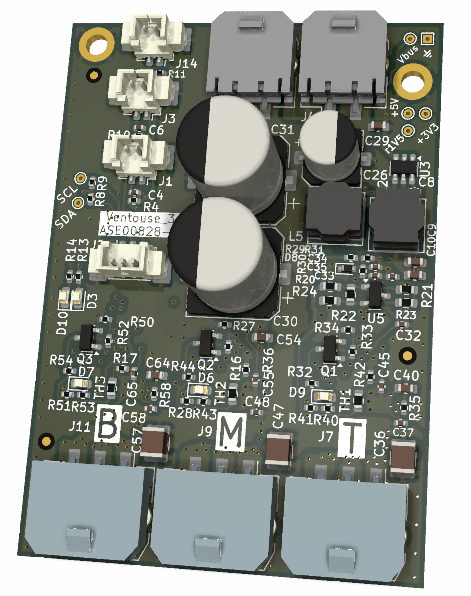

# "Ventouse_3d" Electronic Board

"Ventouse_3d" is build from "Themis" as it aims on driving Orbita 3 Dofs. It is paired with boards "Poulpe_3d" that controls 3 small BLDC Motors.

## Basically
 - Primarly designed for Reachy 2 gamma.
 - Powered in 24V.
 - Designed with KiCAD 7.
